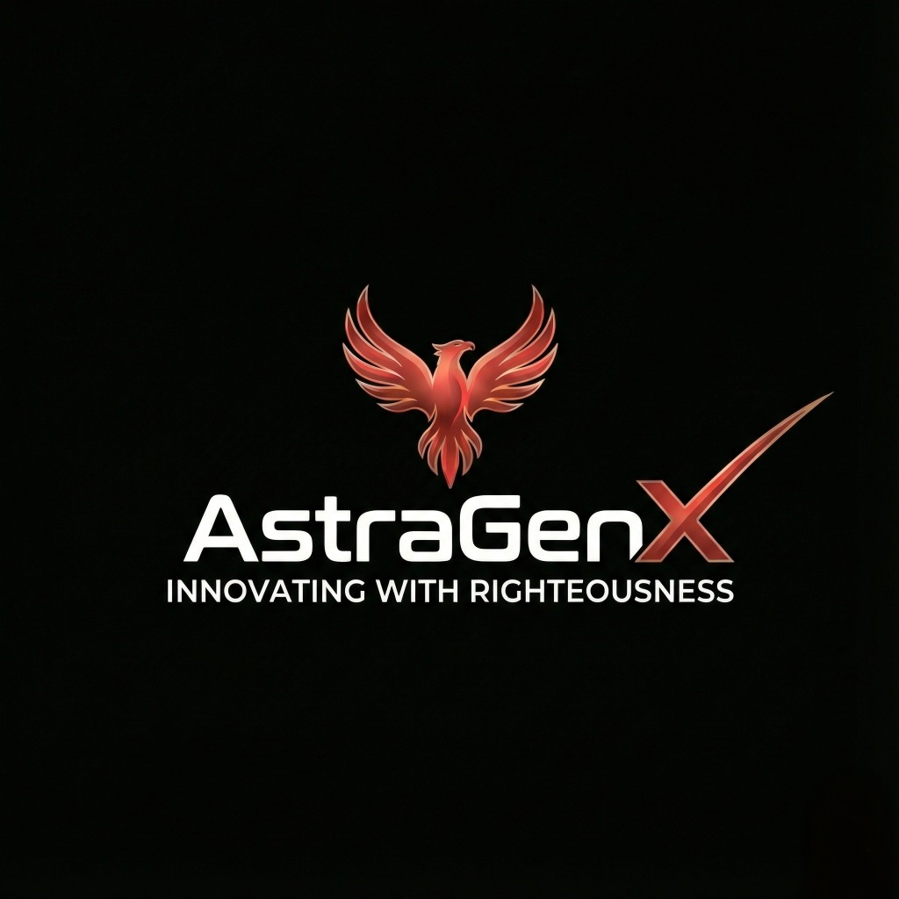
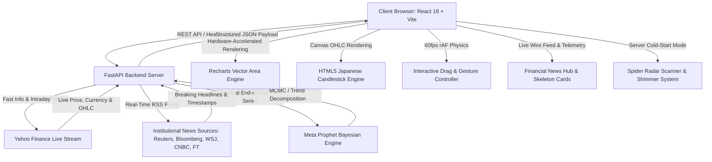

<div align="center">

  

  # ⚡ ArthaX 2.0
  ### Next-Gen Institutional Financial Intelligence, Real-Time News Wire & Meta Prophet AI Forecasting Engine
  <sub>Powered by <strong><a href="https://astragenx.netlify.app/">AstraGenX</a></strong></sub>

  <p align="center">
    <a href="https://astragenx-arthax.vercel.app/"></a>
    <a href="https://github.com/Bangadhipati/ArthaX-2.0"></a>
    <a href="https://react.dev/"></a>
    <a href="https://fastapi.tiangolo.com/"></a>
    <a href="https://facebook.github.io/prophet/"></a>
    <a href="https://finance.yahoo.com/"></a>
    
  </p>

  <p align="center">
    <strong>ArthaX 2.0</strong> is an enterprise-grade financial intelligence platform uniting high-frequency market streaming, real-time institutional financial news wire, real-time FX currency conversion, interactive hardware-accelerated charting, and Meta Prophet Bayesian predictive modeling — wrapped in an Apple Cupertino frosted glassmorphism interface.
  </p>

  <p align="center">
    <a href="https://astragenx-arthax.vercel.app/"><strong>🌐 Open Live Terminal »</strong></a> •
    <a href="https://huggingface.co/spaces/Bangadhipati/ArthaX"><strong>🤗 Old Prototype (Hugging Face) »</strong></a> •
    <a href="#-system-features"><strong>Explore Features »</strong></a> •
    <a href="#-local-development--running-guide"><strong>Run Locally »</strong></a> •
    <a href="#-cloud-deployment-guide"><strong>Deployment Guide »</strong></a>
  </p>

</div>

---

## 🚀 The Evolution: Gradio Prototype → Enterprise Architecture

**ArthaX** originally began as an exploratory research prototype deployed on Hugging Face Spaces ([🤗 Hugging Face Space](https://huggingface.co/spaces/Bangadhipati/ArthaX) / [Old_Prototype/](Old_Prototype/)) built using Python and Gradio Blocks. While Gradio was suitable for rapid proof-of-concept testing, scaling to a real-world institutional financial terminal revealed fundamental architectural bottlenecks that demanded a complete transformation into **ArthaX 2.0**, now deployed live on Vercel at **[astragenx-arthax.vercel.app](https://astragenx-arthax.vercel.app/)**.

### 🔍 Architecture Comparison

| Dimension | ⚠️ ArthaX 1.0 (Gradio Prototype) | ⚡ ArthaX 2.0 (Enterprise Stack) |
| :--- | :--- | :--- |
| **Architecture** | Monolithic Python script running Gradio on a single blocking thread. | Decoupled client-server microservice: Async **FastAPI backend** + **React 18 SPA**. |
| **Market Intelligence & News** | No news feed or institutional sentiment monitoring. | **Real-Time Financial Intelligence & Live News Wire** with category filtering (Global, Tech & AI, India & NSE, Crypto & Macro), dynamic relative time, and publisher attribution. |
| **Chart Rendering** | Server-side Python generated static Plotly HTML/SVG with jarring white flash reloads. | Hardware-accelerated client-side vector charts with **Recharts**, **HTML5 Canvas**, and **0ms latency**. |
| **Chart Interaction** | Coarse, jerky pan/zoom with network roundtrips for each interaction. | Smooth **60fps drag-to-pan** throttled via `requestAnimationFrame` + Trackpad pinch gesture zoom. |
| **Market Timeframes** | Limited to coarse daily views (`1m`, `6m`, `1y`, `5y`, `max`). | True high-frequency intraday feeds (**`1h`**, **`6h`**, **`12h`**, **`24h`**, **`1w`**, **`1m`**, **`6m`**, **`1y`**, **`5y`**, **`MAX`**) with multi-resolution axis down to seconds. |
| **AI Trajectory** | Convoluted curve mixing past and future; confusing confidence bands touching axes. | **Future-only forward trajectory** anchored cleanly at current price with true floating **95% Bayesian Confidence Corridors** and 15% dynamic headroom. |
| **Server Cold-Start** | Blank screens or disconnected error state during cloud wake-up. | **Spider Radar Loading Animation** and **Skeleton Shimmer Cards** that automatically stream live data as soon as the server wakes up. |
| **Routing & Persistence** | No URL routing; refresh resets everything. | **URL Hash Routing** (`#market-intelligence`, `#finance-news`) + `localStorage` synchronization preserving active views on hard refresh (`F5` / `Ctrl+R`). |
| **FX Intelligence** | Static USD-to-INR text mentions. | **Asset-Native auto-detection** converting foreign assets in real time to INR while cleanly auto-hiding for domestic rupee stocks. |
| **UI & Experience** | Generic default Gradio gray blocks with mobile layout collisions. | State-of-the-art **Apple Cupertino dark glassmorphism**, responsive layout, synchronized Sidebar telemetry badges, and collapsible macOS drawer. |

---

## ✨ System Features

### 1. 🔮 Meta Prophet Bayesian Predictive Trajectory
- **Forward-Only Horizons:** Computes forward-looking financial forecasting for 1 to 5 years into the future, dynamically anchored at the stock's latest verified market price.
- **95% Floating Confidence Corridor:** Implements a Bayesian uncertainty corridor ($[yhat\_lower, yhat\_upper]$) rendered with dashed boundary guide rails and soft luminescence, featuring automatic 15% headroom padding so corridor bands never clip against the top axis.
- **Corridor vs AI Candles Switch:** Toggle between smooth confidence band ribbons and forward projected probabilistic AI candlesticks with dynamic volatility wicks.
- **Multi-Seasonality Decomposition:** Calibrates daily, weekly, and yearly market seasonality trends to forecast medium-to-long term price evolution.

### 2. 📰 Financial Intelligence & Real-Time News Wire
- **Ultra-Fresh Live Feeds:** Direct institutional RSS feed pipeline with real-time 30-second cache TTL, pulling stories published minutes ago from verified sources (Bloomberg, Reuters, WSJ, CNBC, FT, Mint, Economic Times).
- **Curated Category Tabs:** Seamless category switching across **All News**, **Global Markets**, **Tech & AI**, **India & NSE**, and **Crypto & Macro**.
- **Domestic Indian Market Prioritization:** Indian equities and NSE/BSE updates receive algorithmic priority within the main aggregate wire feed.
- **Dynamic Relative Timestamps:** Live relative time calculation against client clock (`Just now`, `4m ago`, `18m ago`) updated continuously without layout jump.
- **Interactive Card Hover Animations:** Hovering anywhere on a news card automatically transitions its explore / full-coverage action button into its active glow state.
- **Synchronized Live/Offline Telemetry:** Header badge displays `LIVE` (green) or `OFFLINE` (red pulse) while loading/refreshing, perfectly synchronized with the macOS Sidebar telemetry badge.
- **Debounced Server Search:** Instant keyword, ticker, or company name search with zero-flash updates.

### 3. 🕷️ Cyber Spider Radar Loading & Auto-Wake Stream
- **Continuous Radar Scanner:** When the cloud backend is cold-starting or asleep, the chart displays an 8-spoke polygonal concentric spiderweb radar with a 360° sweeping beam and pulsating cyber nodes.
- **Zero-Friction Live Streaming:** A background polling loop constantly monitors server health. As soon as Render turns on the server, live candlestick feeds and AI projections stream in automatically without requiring a manual refresh.
- **On-Demand Connect Trigger:** An interactive `Connect AI` button in the top header bar allows instantaneous manual wake-up triggers at any time.

### 4. 💀 Apple Frosted Skeleton Shimmer System
- **Holistic Skeleton Feedback:** While the server spins up or fetches new ticker datasets, all component cards across the platform display a luxury dark-mode skeleton shimmer (`rgba(255, 255, 255, 0.03)` to `rgba(100, 210, 255, 0.12)`).
- **Smooth Content Transitions:** The Hero Ticker, 4-Card Metrics Grid (AI Target, 52-Week Range, Valuation & Fundamentals, Currency FX), and AI Intelligence Narrative Card all preserve their exact layout geometry before resolving into real metrics.

### 5. 🕯️ Dual Charting Modes & Intraday Resolution
- **Area & Japanese Candlestick Modes:** Seamless one-click toggling between modern glowing Area trendlines and institutional Japanese Candlestick (OHLC) charts.
- **Intraday High-Frequency Feeds:** Comprehensive range selection spanning `1h` (1-minute bars), `6h`, `12h`, `24h` (5-minute bars), `1w` (15-minute bars), `1m`, `6m`, `1y`, `5y`, and `MAX`.
- **Responsive Multi-Resolution X-Axis:** Dynamic date-time formatting adapting from macro dates (`Jan '25`) down to micro granular `HH:mm:ss` timestamps upon deep zoom.
- **Responsive Zoom Panel:** Floating Cupertino zoom panel providing dedicated **Pan Mode**, **Zoom In (+)**, **Zoom Out (-)**, and icon-responsive **Reset** buttons.

### 6. 💱 Dynamic Currency & FX Intelligence
- **Asset-Native Detection:** Automatically recognizes the asset's native listing currency (`USD`, `EUR`, `GBP`, `JPY`, `INR`, etc.).
- **Real-Time INR Dual-Pricing:** Calculates and displays converted Rupee values ($\approx ₹XX,XXX$) alongside native currencies in real time.
- **Domestic INR Intelligence:** Domestic Indian equities (e.g., `RELIANCE.NS`, `TCS.NS`, `INFY.NS`) automatically detect native Rupee denomination and suppress redundant currency conversion badges.

### 7. 📱 Apple Cupertino Design System & State Persistence
- Built with custom Vanilla CSS design tokens adhering to macOS dark glassmorphism standards (`--apple-bg`, `--card-bg`, `--border-subtle`, `--apple-blue`, `--apple-green`, `--apple-gold`).
- **URL Hash Routing:** URL updates seamlessly with `#market-intelligence` and `#finance-news`, retaining current navigation and ticker selection on hard refresh (`F5` / `Ctrl+R`).
- **Orbitron Branding & Collapsible Sidebar:** Futuristic Orbitron brand title with AstraGenX footer, Quick Watch tape for blue-chip tickers, and a mobile-friendly responsive navigation drawer.

---

## 🏛️ System Architecture



---

## 📂 Architecture & Repository Structure

```
ArthaX 2.0/
├── backend/                        # High-Performance FastAPI Python Backend
│   ├── main.py                     # REST Endpoints, Prophet ML Engine, News Pipeline & Yahoo Stream
│   ├── requirements.txt            # Python dependencies (FastAPI, Prophet, yfinance, uvicorn)
│   └── Procfile                    # Cloud deployment specification (Render/Uvicorn)
├── frontend/                       # Modern React 18 + Vite Web Application
│   ├── src/
│   │   ├── components/
│   │   │   ├── Navbar.jsx          # Live search with debounced ticker autocomplete & Orbitron logo
│   │   │   ├── Sidebar.jsx         # macOS collapsible sidebar with dynamic Live/Offline telemetry
│   │   │   ├── FinanceNewsPage.jsx # Real-time financial intelligence wire with live filters & search
│   │   │   ├── HeroTicker.jsx      # Price hero with dual currency & skeleton shimmer
│   │   │   ├── StockChart.jsx      # Area & Candlestick chart engine with rAF drag-to-pan
│   │   │   ├── RangeAndDepthControls.jsx # Timeframe pills (1h-MAX) & Horizon controls
│   │   │   ├── MetricsGrid.jsx     # 4-card frosted glass financial telemetry grid with skeletons
│   │   │   ├── IntelligenceCard.jsx# AI narrative thesis, catalysts & sentiment with skeletons
│   │   │   ├── SpiderLoadingAnimation.jsx # 8-spoke cyber radar loading scanner
│   │   │   ├── SpotlightModal.jsx  # macOS Spotlight search modal
│   │   │   └── ComingSoonPage.jsx  # Frosted placeholder for roadmap modules
│   │   ├── api.js                  # Asynchronous HTTP clients with backend health polling
│   │   ├── mockData.js             # Authentic market presets & fallback datasets
│   │   ├── index.css               # Apple Cupertino Dark Glass Design System & animations
│   │   └── App.jsx                 # Central application state, hash routing & reactive orchestrator
│   ├── public/                     # Static assets, branding logo & favicon
│   ├── package.json                # Frontend dependencies (React, Recharts, Lucide)
│   └── vite.config.js              # Vite bundler configuration & local API proxy
├── Old_Prototype/                  # Archived v1.0 Gradio Research Prototype
│   ├── app.py                      # Original Gradio Blocks application script
│   ├── requirements.txt            # Original Gradio dependencies
│   └── README.md                   # Archived prototype documentation
├── run_local.bat                   # 1-Click Windows development launcher
├── .gitignore                      # Production Git exclusion configuration
└── README.md                       # Master project documentation
```

---

## ⚙️ Local Development & Running Guide

### 📋 Prerequisites
- **Node.js**: `v18.0.0` or higher ([Download Node.js](https://nodejs.org/))
- **Python**: `3.10` or `3.11` recommended ([Download Python](https://www.python.org/))
- **Git**: Installed and available in PATH

---

### ⚡ 1-Click Launch (Windows)
Double-click `run_local.bat` in the repository root. It automatically opens two terminal windows to concurrently start:
1. The **FastAPI backend** on port `8000`
2. The **Vite dev server** on port `5173`

---

### 🛠️ Manual Step-by-Step Setup

#### Step 1: Start the Backend (FastAPI + Prophet)
Open a terminal in the project root:

```bash
cd backend

# Create and activate a virtual environment
python -m venv .venv

# On Windows:
.venv\Scripts\activate
# On macOS / Linux:
source .venv/bin/activate

# Install dependencies
pip install -r requirements.txt

# Launch FastAPI development server
python main.py
```
- Server URL: **`http://localhost:8000`**
- Interactive Swagger API Documentation: **`http://localhost:8000/docs`**

#### Step 2: Start the Frontend (React + Vite)
Open a second terminal window in the project root:

```bash
cd frontend

# Install npm dependencies
npm install

# Launch Vite development server
npm run dev
```
- Client App URL: **`http://localhost:5173`**

---

## ☁️ Cloud Deployment Guide

The decoupled monorepo architecture enables independent, free-tier deployment for both the backend API and frontend SPA.

### Component Overview
| Component | Platform | Environment | Configuration |
| :--- | :--- | :--- | :--- |
| **Backend API** | [Render](https://render.com) | Python 3 Web Service | `backend/Procfile` |
| **Frontend SPA** | [Vercel](https://astragenx-arthax.vercel.app/) *(Live)* | Node.js / Vite Static | Root directory: `frontend` |

---

### 1. Backend Deployment (Render)
1. Sign in to [Render.com](https://render.com/) and link your repository.
2. Click **New +** → **Web Service**.
3. Select your repository and configure:
   - **Name:** `arthax-api` (or custom name)
   - **Root Directory:** `backend`
   - **Runtime:** `Python 3`
   - **Build Command:** `pip install -r requirements.txt`
   - **Start Command:** `uvicorn main:app --host 0.0.0.0 --port $PORT`
   - **Instance Type:** `Free`
4. Click **Create Web Service**. Once deployed, copy your backend URL (e.g., `https://arthax-api.onrender.com`).

#### 💡 Keeping Render Free Tier Awake (Optional Keep-Alive)
Render free services spin down after 15 minutes of inactivity:
1. Create a free account at [UptimeRobot.com](https://uptimerobot.com/).
2. Add a new **HTTP(s)** monitor pointing to:
   `https://<your-render-backend-url>/api/health`
3. Set the monitoring interval to **every 5 minutes**.
4. The backend will receive a periodic health ping and stay warm 24/7.
*(Even without a keep-alive monitor, ArthaX 2.0 displays the Spider Radar Animation and automatically loads as soon as the instance spins up!)*

---

### 2. Frontend Deployment (Vercel)
1. Sign in to [Vercel.com](https://vercel.com/) and click **Add New...** → **Project**.
2. Import your repository and configure:
   - **Root Directory:** Click edit and select `frontend`.
   - **Framework Preset:** `Vite`
   - **Build Command:** `npm run build`
   - **Output Directory:** `dist`
3. Under **Environment Variables**, add:
   - **Key:** `VITE_API_URL`
   - **Value:** `https://<your-render-backend-url>` (no trailing slash)
4. Click **Deploy**. Your terminal will be live globally with automatic SSL and edge CDN distribution.

---

## 🔌 API Reference

### 1. Health Check
```http
GET /api/health
```
**Response:**
```json
{
  "status": "healthy",
  "service": "ArthaX Intelligence API",
  "keep_alive": true
}
```

### 2. Ticker Metadata & Intraday History
```http
GET /api/stock/{ticker}?range={range}
```
- **Path Parameter:** `ticker` (e.g., `AAPL`, `NVDA`, `TSLA`, `RELIANCE.NS`, `BTC-USD`)
- **Query Parameter:** `range` (`1h`, `6h`, `12h`, `24h`, `1w`, `1m`, `6m`, `1y`, `5y`, `max`)
- **Response:** Current price, native currency, 24h change %, exchange code, live USD/INR exchange rate, and historical OHLC candles with unix timestamps.

### 3. Meta Prophet AI Forecast
```http
POST /api/forecast
```
**Request Body:**
```json
{
  "ticker": "NVDA",
  "years": 2,
  "horizon": "2y"
}
```
- **Response:** Future-only forecasted trajectory points, upper and lower 95% Bayesian confidence boundaries (`upper`, `lower`), projected candlesticks, CAGR, ROI growth %, and sentiment classification.

### 4. Real-Time Institutional Financial News Wire
```http
GET /api/news?category={category}&q={query}&limit={limit}
```
- **Query Parameters:**
  - `category`: `all`, `markets`, `tech`, `india`, `crypto` (default: `all`)
  - `q`: Optional keyword or company search query (e.g., `Nvidia`, `Apple`, `NIFTY`)
  - `limit`: Number of stories to return (default: `40`, max: `100`)
- **Response:** Chronologically sorted real-time articles with verified publishers, relative timestamps, clean summaries, and topic categories.

### 5. Live Ticker Search Autocomplete
```http
GET /api/search?q={query}
```
- **Query Parameter:** `q` (e.g., `Apple`, `Tesla`, `Tata`, `Microsoft`)
- **Response:** Verified company matches, symbols, exchange codes, and asset types queried dynamically.

---

## 📜 License & Attribution

Distributed under the **MIT License**. Built with passion for quantitative finance, predictive modeling, and human-centric design.

<div align="center">
  <sub>ArthaX 2.0 • Powered by <strong><a href="https://astragenx.netlify.app/">AstraGenX</a></strong></sub><br/>
  <sub>Developed by <strong><a href="https://bangadhipati.netlify.app/">Debarghya Bhowmick</a></strong></sub><br/>
  <sub>Engineered with precision for the next generation of financial analysts and intelligent traders.</sub>
</div>
