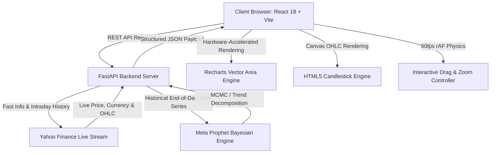

<div align="center">

  

  # ⚡ ArthaX 2.0 (ArthaAstraX)
  ### Next-Gen Institutional Financial Intelligence & Meta Prophet AI Forecasting Engine

  <p align="center">
    <a href="https://github.com/Bangadhipati/ArthaX-2.0"></a>
    <a href="https://react.dev/"></a>
    <a href="https://fastapi.tiangolo.com/"></a>
    <a href="https://facebook.github.io/prophet/"></a>
    <a href="https://finance.yahoo.com/"></a>
  </p>

  <p align="center">
    <strong>ArthaX 2.0</strong> is an enterprise-grade financial intelligence platform uniting high-frequency market streaming, real-time FX currency arbitrage, interactive hardware-accelerated charting, and Meta Prophet Bayesian predictive modeling — wrapped in an Apple Cupertino frosted glassmorphism interface.
  </p>

  <p align="center">
    <a href="#-the-evolution-gradio-prototype--enterprise-architecture"><strong>Read Transformation Story »</strong></a> •
    <a href="#-system-features"><strong>Explore Features »</strong></a> •
    <a href="#-quick-start-local-development"><strong>Run Locally »</strong></a> •
    <a href="Old_Prototype/"><strong>Old Prototype Archive »</strong></a>
  </p>

</div>

---

## 🚀 The Evolution: Gradio Prototype → Enterprise Architecture

**ArthaX** originally began as an exploratory research prototype ([Old_Prototype/](Old_Prototype/)) built using Python and Gradio Blocks for Hugging Face Spaces. While Gradio was exceptional for rapid proof-of-concept testing, scaling to a real-world financial terminal revealed fundamental architectural bottlenecks that demanded a complete transformation into **ArthaX 2.0**.

### 🔍 Why We Evolved

| Dimension | ⚠️ ArthaX 1.0 (Gradio Prototype) | ⚡ ArthaX 2.0 (Enterprise Stack) |
| :--- | :--- | :--- |
| **Architecture** | Monolithic Python script running Gradio on a single blocking thread. | Decoupled client-server microservice: Async **FastAPI backend** + **React 18 SPA**. |
| **Chart Rendering** | Server-side Python generated static Plotly HTML/SVG with jarring white flash reloads. | Hardware-accelerated client-side vector charts with **Recharts**, **HTML5 Canvas**, and **0ms latency**. |
| **Chart Interaction** | Coarse, jerky pan/zoom with network roundtrips for each interaction. | Smooth **60fps drag-to-pan** throttled via `requestAnimationFrame` + Trackpad pinch gesture zoom. |
| **Market Timeframes** | Limited to coarse daily views (`1m`, `6m`, `1y`, `5y`, `max`). | True high-frequency intraday feeds (**`1h`**, **`6h`**, **`12h`**, **`24h`**, **`1w`**, **`1m`**, **`6m`**, **`1y`**, **`5y`**, **`MAX`**) with multi-resolution date-time axis down to seconds. |
| **AI Trajectory** | Convoluted curve mixing past and future; confusing confidence bands touching axes. | **Future-only forward trajectory** anchored cleanly at current price with true floating **95% Bayesian Confidence Corridors** and 15% dynamic headroom. |
| **FX Intelligence** | Static USD-to-INR text mentions. | **Asset-Native auto-detection** converting foreign assets in real time to INR while cleanly auto-hiding for domestic rupee stocks. |
| **UI & Experience** | Generic default Gradio gray blocks with mobile layout collisions. | State-of-the-art **Apple macOS dark glassmorphism**, responsive drawer, zero control collisions, and live market sub-headers. |
| **Transition Safety** | Switching tickers left the older company graph visible during calculation. | **Cupertino Frosted Loading Overlay** that conceals stale data and visualizes real-time model synthesis. |

---

## ✨ System Features

### 1. 🔮 Meta Prophet Bayesian Predictive Trajectory
- **Forward-Only Horizons:** Computes forward-looking financial forecasting for 1 to 5 years into the future, dynamically anchored at the stock's latest verified market price.
- **95% Floating Confidence Corridor:** Implements a true Bayesian uncertainty corridor ($[yhat\_lower, yhat\_upper]$) rendered with dashed boundary guide rails and soft luminescence, featuring automatic 15% headroom padding so corridor bands never clip against the top axis.
- **Multi-Seasonality Decomposition:** Calibrates daily, weekly, and yearly market seasonality trends to forecast medium-to-long term price evolution.

### 2. 🕯️ Dual Charting Modes & Intraday Ingestion
- **Area & Candlestick Modes:** Seamless one-click toggling between modern glowing Area trendlines and institutional Japanese Candlestick (OHLC) charts.
- **Intraday High-Frequency Feeds:** Comprehensive range selection spanning `1h` (1-minute bars), `6h`, `12h`, `24h` (5-minute bars), `1w` (15-minute bars), `1m`, `6m`, `1y`, `5y`, and `MAX`.
- **Dynamic X-Axis Formatting:** Formats dates intuitively with Year explicitly labeled (e.g., `Jan '25`), automatically elevating to granular `HH:mm:ss` timestamps upon deep zoom or intraday views.

### 3. 🖱️ 60fps Drag-to-Pan & Gesture Zooming
- **Hardware-Accelerated Drag:** Integrated `requestAnimationFrame` drag throttling ensuring butter-smooth panning without lag or frame drops across desktop mice and mobile touchscreens.
- **Intuitive Zoom Controls:** Floating Cupertino zoom panel providing dedicated **Pan Mode**, **Zoom In (+)**, **Zoom Out (-)**, and **100% Reset** buttons.
- **Gesture Support:** Natural pinch-to-zoom on laptop trackpads and mobile fingers, alongside mouse wheel scroll zooming.

### 4. 💱 Dynamic Currency & FX Intelligence
- **Asset-Native Detection:** Reads the asset's native listing currency (`USD`, `EUR`, `GBP`, `JPY`, `INR`, etc.).
- **Live INR Dual-Pricing:** Automatically calculates and displays real-time converted Rupee values ($\approx ₹XX,XXX$) alongside native currencies.
- **Domestic INR Intelligence:** Domestic Indian equities (e.g., `RELIANCE.NS`, `TCS.NS`, `INFY.NS`) automatically detect native Rupee denomination and suppress redundant currency conversion badges.

### 5. 🛡️ Cupertino Frosted Graph Loading Screen
- **Zero Confusion Guarantee:** When searching a new company, metadata loads in under 300ms while the AI model computes in ~2 seconds. During this window, an Apple frosted loading overlay (`rgba(10, 11, 15, 0.85); backdrop-filter: blur(16px);`) shields the canvas.
- **Visual Feedback:** Animated radial pulse ring, glowing cyan spinner, dynamic title, and shimmer progress line reassure the user that the Prophet model is actively synthesizing data.

### 6. 📱 Responsive Apple Cupertino Design System
- Built with Vanilla CSS design tokens adhering to macOS dark glassmorphism standards (`--apple-bg`, `--card-bg`, `--border-subtle`, `--apple-blue`, `--apple-green`, `--apple-gold`).
- **Collision-Free Mobile Layout:** Pan/Zoom controls and AI Trajectory labels sit on independent vertical lines with mobile legend compression, ensuring zero overlap even on narrow 320px–390px screens.

---

## 🏛️ System Architecture



---

## 📂 Repository Structure

```
ArthaX 2.0/
├── backend/                        # High-Performance FastAPI Python Backend
│   ├── main.py                     # API Endpoints, Prophet Modeling & Yahoo Stream
│   ├── requirements.txt            # Python dependencies (FastAPI, Prophet, yfinance)
│   └── Procfile                    # Cloud deployment specification (Render/Uvicorn)
├── frontend/                       # Modern React 18 + Vite Web Application
│   ├── src/
│   │   ├── components/
│   │   │   ├── Navbar.jsx          # Live search with debounced ticker autocomplete
│   │   │   ├── Sidebar.jsx         # macOS collapsible navigation sidebar
│   │   │   ├── HeroTicker.jsx      # High-impact price hero with dual currency pill
│   │   │   ├── StockChart.jsx      # Area & Candlestick chart engine with rAF drag
│   │   │   ├── RangeAndDepthControls.jsx # Timeframe pills (1h-MAX) & Horizon slider
│   │   │   ├── MetricsGrid.jsx     # 4-card frosted glass financial telemetry grid
│   │   │   ├── IntelligenceCard.jsx# AI narrative thesis, catalysts & sentiment
│   │   │   └── ComingSoonPage.jsx  # macOS frosted placeholder for future modules
│   │   ├── api.js                  # Asynchronous HTTP clients with backend health ping
│   │   ├── mockData.js             # Verified ticker presets & institutional metadata
│   │   ├── index.css               # Apple Cupertino Dark Glass Design System
│   │   └── App.jsx                 # Central application state & reactive layout
│   ├── public/                     # Static assets, branding logo & favicon
│   ├── package.json                # Frontend dependencies (React, Recharts, Lucide)
│   └── vite.config.js              # Vite bundler configuration & local API proxy
├── Old_Prototype/                  # Archived v1.0 Gradio Research Prototype
│   ├── app.py                      # Original Gradio Blocks application script
│   ├── requirements.txt            # Original Gradio dependencies
│   └── README.md                   # Archived prototype documentation
├── DEPLOYMENT_GUIDE.md             # Complete step-by-step cloud deployment manual
├── RUNNING_GUIDE.md                # Quick local setup & troubleshooting reference
├── run_local.bat                   # 1-Click Windows development launcher
├── .gitignore                      # Production Git exclusion configuration
└── README.md                       # Master project documentation
```

---

## ⚙️ Quick Start (Local Development)

### Prerequisites
- **Python**: Version `3.10` or `3.11` (recommended for Meta Prophet)
- **Node.js**: Version `18.x` or higher (with `npm`)

### ⚡ 1-Click Launch (Windows)
Double-click `run_local.bat` in the repository root. It will concurrently initialize the Python virtual environment, install missing packages, start the FastAPI engine on port `8000`, and start the Vite dev server on port `5173`.

---

### 🛠️ Manual Step-by-Step Setup

#### 1. Clone the Repository
```bash
git clone https://github.com/Bangadhipati/ArthaX-2.0.git
cd ArthaX-2.0
```

#### 2. Start the Backend (FastAPI)
```bash
# Navigate to backend directory
cd backend

# Create and activate a virtual environment
python -m venv .venv
# On Windows:
.venv\Scripts\activate
# On macOS / Linux:
source .venv/bin/activate

# Install dependencies
pip install -r requirements.txt

# Launch FastAPI development server
python main.py
```
*Backend server will start at `http://localhost:8000` (Interactive Swagger docs available at `http://localhost:8000/docs`).*

#### 3. Start the Frontend (React + Vite)
In a separate terminal window:
```bash
# Navigate to frontend directory
cd frontend

# Install npm dependencies
npm install

# Launch Vite development server
npm run dev
```
*Frontend will launch at `http://localhost:5173`.*

---

## 🔌 API Reference

### Health Check
- `GET /health`
  - Returns: `{"status": "healthy", "service": "ArthaX API"}`

### Ticker Metadata & Historical History
- `GET /api/stock/{ticker}?range={1h|6h|12h|24h|1w|1m|6m|1y|5y|max}`
  - Returns current asset price, native currency, exchange, 24h change %, and historical OHLC data with timestamps.

### Meta Prophet AI Forecast
- `GET /api/forecast/{ticker}?years={1-5}`
  - Returns future-only predicted price points, upper and lower 95% Bayesian confidence boundaries, growth trajectory metrics, and risk assessments.

### Live Ticker Search Autocomplete
- `GET /api/search?q={query}`
  - Returns verified company matches, symbols, and exchange codes queried dynamically from Yahoo Finance.

---

## 🚀 Cloud Deployment

| Component | Target Platform | Instructions Reference |
| :--- | :--- | :--- |
| **Backend API** | [Render](https://render.com) (Python 3 Web Service) | See [DEPLOYMENT_GUIDE.md](DEPLOYMENT_GUIDE.md#backend-deployment-render) |
| **Frontend SPA** | [Vercel](https://vercel.com) / [Netlify](https://netlify.com) (Vite Build) | See [DEPLOYMENT_GUIDE.md](DEPLOYMENT_GUIDE.md#frontend-deployment-vercel) |

---

## 📜 License & Attribution
Distributed under the **MIT License**. Built with passion for quantitative finance, predictive modeling, and human-centric design.

<div align="center">
  <sub>Engineered with precision for the next generation of financial analysts and intelligent traders.</sub>
</div>
